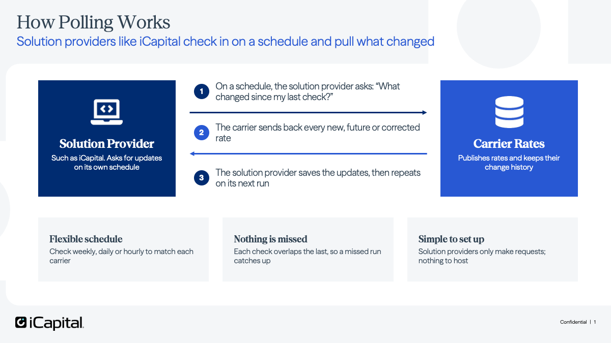
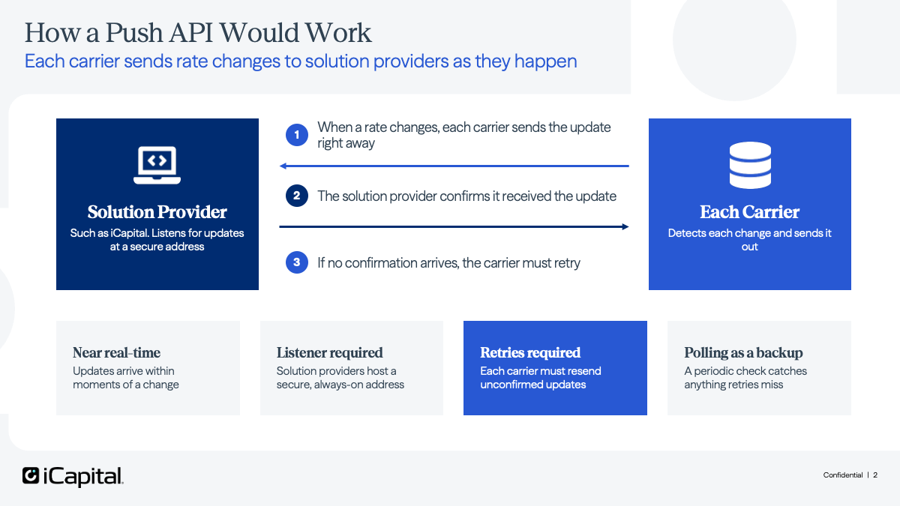

# Push and Pull Mechanisms

This document defines how solution providers (such as iCapital) receive rate changes from carriers. It starts with the difference between push and pull, then covers the mechanics of each, and closes with the decisions from the planning meeting. The pull (polling) mechanics are specified on `GET /v1/product-rates/{id}`: the two independent date axes, the timestamp contract, and the query parameters required to retrieve corrections and pre-announced future rates.

## Decisions and notes (October 9, 2026 planning meeting)

- **Push vs. pull:** push will be used for new business rates and corrections, while pull functionality for historical and renewal rates will be considered in future phases.
- **Initial scope:** Phase 1 will focus on new business rates, with historical and renewal rates addressed later.
- **Access control:** carriers are responsible for determining which solution providers can access their rate information.
- **Rate announcements:** API updates should align with carrier rate announcements and effective dates.
- **API updates:** a new ID field will be added to simplify troubleshooting and rate referencing.

## Overview

The two models differ in who starts the conversation.

- **Pull (polling):** the solution provider reaches out to the carrier's rate API on a schedule it controls and asks one question: *what has changed since my last check?*


- **Push:** the direction flips. Instead of solution providers asking, each carrier notifies them as soon as a rate is published or corrected.


## Push mechanics

With a push model the carrier notifies the solution provider as soon as a rate is published or corrected.

### Delivery flow

1. The solution provider hosts a secure web URL.
2. When a rate is published or corrected, the carrier calls that address with the change.
3. The solution provider replies to confirm receipt.
4. If no confirmation arrives, the carrier retries.

### Carrier responsibilities

Every carrier has to build and operate the retry mechanism:

- resending unconfirmed updates,
- backing off when a solution provider is down, and
- tracking what was delivered.

With polling, none of this is needed on the carrier side.

### Solution provider responsibilities

Each solution provider must build and run an always-available, secured endpoint, and confirm every update it receives.

## Pull (polling) mechanics

### Two date axes

| Axis | Fields | Type | Answers |
| --- | --- | --- | --- |
| Effective | `effectiveDate`, `expiryDate` | `date` | Which rate applies in the market on a given date |
| Modification | `created`, `modified` | `date-time` (RFC 3339) | When the entry was recorded or changed |

The axes are independent. A rate effective `2026-10-01` may be created on `2026-09-21` and corrected on `2026-09-25`. Retrieving rates and detecting changes are therefore two different queries.

### Timestamp format

`created` and `modified` are `format: date-time`, which OpenAPI 3.1 defines via JSON Schema 2020-12 as RFC 3339 §5.6. **The UTC offset is mandatory.**

```text
2026-09-20T16:50:00Z          valid
2026-09-20T16:50:00-04:00     valid
2026-09-20T16:50:00           invalid: no offset
```

RFC 3339 carries a UTC offset. This is sufficient for `created` and `modified`, which are instants and can be compared across timezones.

`effectiveDate` and `expiryDate` are `format: date` (RFC 3339 `full-date`) and carry no offset. This is correct: they denote a market calendar date, independent of timezone.

**Implementer note.** In JSON Schema 2020-12, `format` is annotation-only; validators do not assert it unless the format-assertion vocabulary is enabled. Producers must be held to RFC 3339 by the field description and an explicit `pattern`, not by `format` alone.

### `created` and `modified` normative rules

1. On creation, `created === modified`.
2. On update, `modified` is set to the actual instant of modification.
3. `modified` advances **only** when a consumer-visible rate value changes. A cosmetic republish must not advance it.
4. `modified` never decreases.
5. `modified >= created` always.

Rule 1 is what makes change classification possible. Rule 3 prevents both spurious polling work across all consumers and silently undetectable value fixes.

### Change classification

Consumers derive the nature of each change from fields already required in the response. No additional fields are needed.

| | `effectiveDate <=` today | `effectiveDate >` today |
| --- | --- | --- |
| `created == modified` | New rate, currently in force | **Pre-announcement**: future rate |
| `created < modified` | **Correction** to a live rate | Revision of a rate not yet in force |

Only a correction to a live rate implies downstream restatement. A revision of a not-yet-effective rate does not, because nothing has been credited against it.

### Polling parameters

| Parameter | Type | Behavior |
| --- | --- | --- |
| `modifiedFrom` | `date-time` (RFC 3339) | Return entries whose `modified` is at or after this instant |
| `modifiedTo` | `date-time` (RFC 3339) | Return entries whose `modified` is at or before this instant |

```http
GET /v1/product-rates/12345A678?modifiedFrom=2026-09-20T16:50:00-04:00
```

This returns every rate entry on that product changed since the given instant (corrections to live rates and newly published future rates) in a single call.

`modifiedFrom` and `modifiedTo` must not imply any effective-date filter. Entries with a future `effectiveDate` must be returned, or else pre-announced rates never surface to pollers.

### `effectiveDate` selection semantics

`effectiveDate` is a business-specific point-in-time query.

> Return the rate that is valid on the requested date for the given product. If more than one rate qualifies, take the latest one. Resolve separately for each scope and variation.

```sql
effectiveDate <= :requestedDate
AND (expiryDate IS NULL OR expiryDate >= :requestedDate)
→ max(effectiveDate), per (scope, variationId, rateVariationId)
```

### Polling contract

**Use an overlapping trailing window.**

Required consumer behavior:

1. Set `modifiedFrom` to the last successful run minus a margin (for example one hour), so consecutive windows overlap.
2. Upsert idempotently. Entries are delivered more than once by design. Callers can optimize upserts by comparing the `modified` timestamps with what is in their database. If the timestamps are identical, the received rate can be skipped.
3. Advance the watermark only after the batch has been committed.

Example: a job running every four hours:

```http
GET /v1/product-rates/{id}?modifiedFrom=2026-09-21T11:50:00Z&modifiedTo=2026-09-21T16:50:00Z
```

Because both bounds are instants, there is no day-boundary or timezone hazard, and a missed run self-heals on the next cycle provided the overlap exceeds the gap.

Duplicates are expected and harmless. Cadence is up to the solution provider: less often for carriers with fixed rate publish dates, daily or more often for carriers that can change rates at any time.
